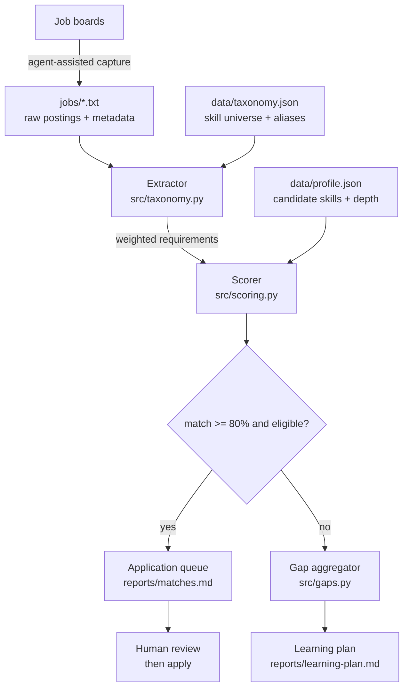

# job-match-pipeline

A job-search pipeline that scores real postings against a candidate profile, decides
which are worth applying to, and turns everything it rejects into a ranked learning plan.

Built because applying to roles one at a time is slow and tells you nothing. Scoring
fifty postings tells you two useful things at once: which ones to actually spend effort
on, and precisely which skills keep appearing in the ones you miss.

## Why this exists

Job searching has an asymmetry problem. The signal you need most — *why am I not
qualified for the roles I want?* — is exactly the signal rejection never gives you.
Postings state their requirements plainly before you apply, so the gap is computable in
advance. This pipeline computes it.

## Architecture



Four stages, each independently testable:

| Stage | Module | Responsibility |
|---|---|---|
| Extract | `src/taxonomy.py` | Detect which skills a posting asks for, and how hard it asks |
| Score | `src/scoring.py` | Compare against the profile; produce match % and eligibility |
| Aggregate | `src/gaps.py` | Rank missing skills by demand across rejected postings |
| Report | `run.py` | Render both outputs as Markdown |

## The scoring model

```
match % = Σ(weight × depth_credit of skills the candidate has) / Σ(weight of all skills the posting asks for)
```

Three decisions in that formula are worth explaining, since they're what make the number
mean anything:

**1. The denominator is the posting's demands, not the candidate's skills.**
Scoring "how much of my CV is relevant" rewards a long CV. Scoring "how much of what
they asked for do I have" answers the question that actually decides the outcome.

**2. Requirements are weighted by how the posting phrases them.**
A skill in a `Requirements` block scores `1.0`. The same skill under `Even better if you
have` or followed by `is a plus` scores `0.5`. Section state carries line to line, since
postings mark optional blocks with a header and then never repeat the qualifier. Without
this, a posting with a long wishlist looks identical to one with a long must-have list.

**3. Credentials are not experience.**
The profile records depth per skill — `strong`, `working`, or `exposure` — and
`exposure` (a certificate or coursework, no production use) earns half credit. This
keeps the score honest about the difference between "I shipped this" and "I took a
course on this", which is exactly the difference an interviewer will probe.

Eligibility is scored separately from fit, because they fail for unrelated reasons. A
role can be a 90% skills match and still be unreachable — the pipeline surfaces both
rather than collapsing them into one number.

## Deliberate non-goal: it does not submit applications

The pipeline stops at a scored, ranked queue. A human reads it and decides.

This is a design choice, not a missing feature:

- Most job boards prohibit automated application submission in their terms of service.
  An auto-apply bot risks the account it depends on.
- Applications are irreversible and attributed to a real person. An 80% keyword match
  is not evidence that an application is *good*, and a bad one costs a real opportunity.
- Screening questions frequently require truthful, specific answers that a scoring
  heuristic has no basis to generate.

Automating the research and ranking is a genuine force multiplier. Automating the
submission moves risk onto the candidate while removing the judgement that makes an
application work.

## Usage

```bash
python3 run.py                  # score every posting in jobs/
python3 run.py --threshold 75   # change the apply/gap cutoff
```

Postings are plain text with optional headers:

```
TITLE: Applied AI Engineer
COMPANY: Example Corp
LOCATION: Toronto, ON (Remote)
URL: https://...

<description body>
```

Outputs land in `reports/`:
- `matches.md` — every posting ranked, with matched / partial / missing skills per role
- `learning-plan.md` — missing skills across sub-threshold postings, ranked by demand

## Configuration

- `data/profile.json` — the candidate's skills, each with depth and supporting evidence.
  The only personal file; swap it to run the pipeline for someone else.
- `data/taxonomy.json` — the skill universe. Each canonical skill lists the surface forms
  that appear in real postings (`next.js`, `nextjs`, `next js`), so spelling variance
  doesn't register as a missing skill.

## Current limitations

- Detection is lexical. A posting describing a skill without naming it is missed, and a
  skill named in passing ("we use X, you won't touch it") is counted.
- The 0.5 optional weighting is a judgement call, not a calibrated value.
- Capture is agent-assisted rather than a scheduled scraper — deliberately, to stay
  inside job-board terms of service.

## Sample output

From five live postings (Oct 2026) for Forward Deployed / Applied AI Engineer roles:

```
MATCH  DECISION   ELIGIBILITY  ROLE
86%    APPLY      check        Forward Deployed Engineer — Mainloop (Leyton)
64%    GAP        eligible     AI Engineer - Forward Deployed — Caspian One
47%    GAP        eligible     AI Engineer, New Grad — Jobright.ai
46%    GAP        eligible     Agent Deployment Engineer — Decagon
33%    GAP        eligible     Applied AI Engineer, Agents and Automations — Cohere
```

The aggregated gap across those four misses: `ai_agents` and `model_evaluation` each
appeared as a hard requirement in three of them — which is the study list, derived rather
than guessed.
